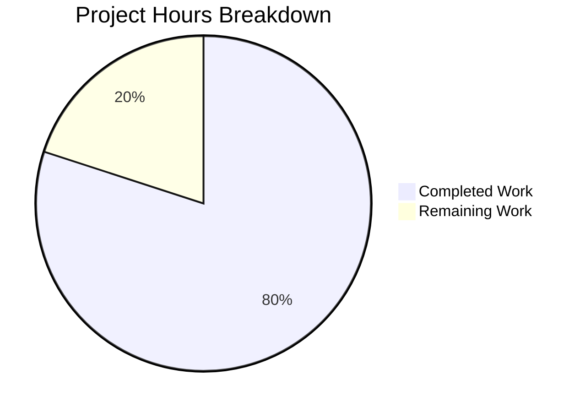
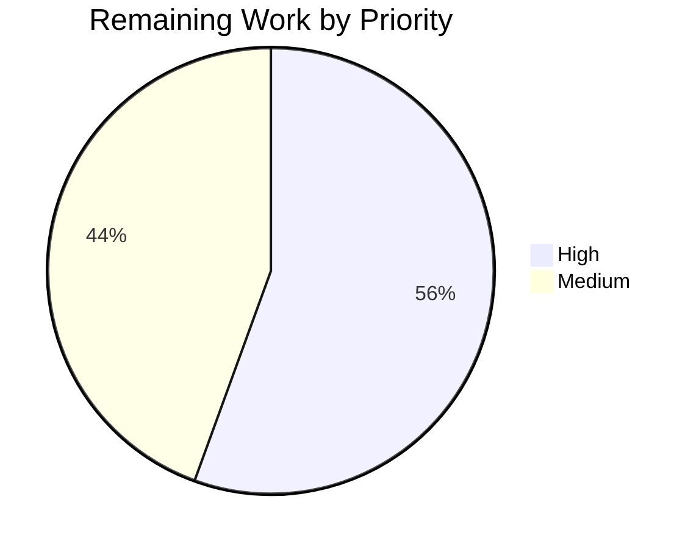

# 1. Executive Summary

## 1.1 Project Overview

This project is a three-file, zero-dependency Node.js tutorial HTTP server: `server.js` (148 lines) is the whole program, `package.json` declares the runtime floor and the start script, and `README.md` documents it. `GET /hello` returns `200` with `Hello world`; everything else returns `404` with `Not Found`; each request logs one console line; the port comes from `PORT`, defaulting to `3000`; and `SIGINT` shuts it down cleanly.

## 1.2 Completion Status

36 of the 45 scoped hours are complete: **80.0% complete** (36 ÷ (36 + 9) × 100). Completed hours cover the program, manifest and documentation plus the acceptance verification run against the live process; the 9 remaining hours are Section 2.2's four closure items.



Completed = Dark Blue (#5B39F3); Remaining = White (#FFFFFF). Centre label: **80.0% complete**.

| Metric | Hours |
|--------|-------|
| Total Hours | 45 |
| Completed Hours (AI + Manual) | 36 |
| Remaining Hours | 9 |

## 1.3 Key Accomplishments

- Both published contracts hold exactly as documented, down to the header values and byte-exact bodies.
- Every documented route boundary behaves as documented, including `HEAD`, trailing slashes, query strings and unparseable targets.
- One correctly formatted console line per request, written before routing, verified at 120,000 requests.
- `PORT` honoured, defaulted and refused exactly as documented; privileged ports never bound.
- Startup and shutdown verified live, with exit status `0` and a closed listener.
- Bind failures caught with actionable stderr lines and exit status `1`, including descriptor exhaustion.
- Performance and concurrency gates met: worst latency sample 0.001445 s; 50 of 50 concurrent requests answered `200`.
- Manifest and documentation complete: `npm start` serves the route, and the documented run-and-probe path was executed verbatim.

## 1.4 Critical Unresolved Issues

4 of the 15 scoped items carry an open item or an accepted caveat.

| Issue | Impact | Owner | ETA |
|-------|--------|-------|-----|
| A `SIGINT` delivered before the process reaches its signal registration ends it with status `130` instead of `0` (`server.js:148`) | Low — a window of tens of milliseconds at startup; the README documents it and its recipe waits for the bind | Developer | Next release |
| The resource-stability acceptance bound of ~500 kB does not reproduce reliably on one unchanged build (−364 kB to +1,096 kB observed) | Low — the property holds, but a correct build can fail the row | Developer | Next release |
| The declared runtime floor (Node.js v18.0.0) has never been executed; it is honoured by reading the source | Medium — an edit could exceed the floor and pass every check on a modern runtime | Developer | Before general use |
| A client aborting mid-response, sustained pipelining, and a request carrying a body were never driven | Low — no route reads a body, and the response path is a single write | Developer | Next release |

## 1.5 Access Issues

No access issues identified. The project installs nothing, declares no dependency, and needs no registry token, service credential, database or cloud account.

## 1.6 Recommended Next Steps

1. [High] Demonstrate the declared runtime floor on a Node.js 18 runtime and settle the prerequisite wording with it.
2. [High] Replace the single-pair resource-stability check with an assertion that reproduces.
3. [Medium] Settle the startup signal window against the fixed signal-registration order.
4. [Medium] Extend the documented verification with the client behaviours no check covered.
5. [Low] Decide whether the tutorial stays pinned to an end-of-life runtime or moves its floor and prerequisite together.

# 2. Project Hours Breakdown

## 2.1 Completed Work Detail

| Component | Hours | Description |
|-----------|-------|-------------|
| Routing and response writing | 8 | The two-branch dispatch with its terminal catch-all, the two route handlers, and the single response writer that sets the status and the one header literal before ending the response, producing both published contracts. |
| Request logging | 3 | The per-request console line, its ISO-8601 UTC timestamp, and its position as the first statement of the request path so a logged request is always answered. |
| Port resolution and validation | 4 | Reading `PORT` from the environment, the default of 3000, the digits-only pattern with `Number()` and the 1024–65535 bounds, and the refusal path with its byte-exact stderr line and exit status 1. |
| Startup confirmation and failure paths | 4 | The startup line emitted from the listening event, and the two listen-failure branches that log an actionable line to stderr and set exit status 1 without leaking internal detail. |
| Shutdown and runtime-floor discipline | 4 | The guarded `SIGINT` sequence — shutdown line, server close, destruction of tracked sockets, exit status 0 — with socket tracking that stands in for the APIs added after the declared floor. |
| npm manifest | 1 | The manifest with its specified values, the start script and the runtime floor declaration, and no dependency set of any kind. |
| Documentation | 6 | The eight documentation sections, with examples captured from the running process, the documented failure and exit-status behaviour, and the environment-variable reference. |
| Acceptance verification executed | 6 | The functional, configuration, documentation, performance, concurrency, security and sustained-load checks, run against a live server started from the delivered tree. |
| **Total** | **36** | |

## 2.2 Remaining Work Detail

| Category | Hours | Priority |
|----------|-------|----------|
| Demonstrate the declared runtime floor on a Node.js 18 runtime, and settle the prerequisite wording with it | 3 | High |
| Make the resource-stability check reproduce: assert that nothing is retained per request across successive late windows of a sustained run | 2 | High |
| Settle the startup signal window against the fixed signal-registration order — close it in code or record the carve-out | 2 | Medium |
| Cover the client behaviours no check exercised — an aborted response, sustained pipelining, a request carrying a body — and fold them into the documented verification | 2 | Medium |
| **Total** | **9** | |

Completion is measured over this project's own scope only: 36 completed hours ÷ (36 completed + 9 remaining) = **80.0% complete**.

# 3. Test Results

This project ships no test framework, runner or coverage tool, and its specification excludes adding one, so its verification is the acceptance sweep the specification itself defines: commands driven from a shell against the running process. Every count below is from that sweep, executed against a live server started from the delivered tree on ports reserved for the run. **96 assertions executed, 96 passed, 0 failed.**

| Area / Category | Framework | Tests | Passed | Failed | Coverage | What This Proves |
|-----------------|-----------|-------|--------|--------|----------|------------------|
| Response contracts and routing boundaries | curl and raw sockets against the running process; no runner exists or may be added | 25 | 25 | 0 | Not reported — no coverage tool exists in this project | Both published contracts hold exactly as documented, and every route boundary behaves as the documentation states |
| Port configuration and validation | same | 13 | 13 | 0 | Not reported | The port is honoured, defaulted only when absent, and refused with the documented line and status |
| Per-request logging | same | 7 | 7 | 0 | Not reported | Every request writes exactly one correctly formatted line before its response |
| Process lifecycle: startup, shutdown, npm entry point | same | 16 | 16 | 0 | Not reported | The documented startup and shutdown lines, exit status 0 and the manifest start path all behave as documented |
| Failure paths: bind failures and refusals | same | 6 | 6 | 0 | Not reported | Both bind-failure shapes report on stderr with exit status 1 and leak no internal detail |
| Performance and concurrency | same | 2 | 2 | 0 | Not reported | Responses stay far inside the 10 ms bound and concurrent requests are served without blocking |
| Sustained load, log fidelity and resource stability | same | 6 | 6 | 0 | Not reported | 25,000 requests are served with exact log counts, memory that settles while idle, and a clean exit |
| Static gates: security boundaries, manifest, documentation and deliverable set | repository reads and greps | 21 | 21 | 0 | Not reported | The single built-in import, the absent forbidden APIs, the manifest values, the documentation's claims and the three-file deliverable set are all exact |
| **Total** | | **96** | **96** | **0** | | |

### Not Covered

- **The declared runtime floor was never executed.** No Node.js 18 runtime was available for the run, so v18.0.0 is satisfied by reading the source — the socket-tracking shutdown stands in for the APIs added after the floor — rather than by running on it. Run the sweep on v18.0.0 before relying on the declaration.
- **Three client behaviours were never driven:** a client that aborts mid-response, sustained pipelining on a single connection, and a request that carries a body. The response path is a single write and no route reads a body, but none of the three was exercised.
- **The resource-stability bound was exercised but does not reproduce.** The property it protects holds — no state is retained across requests and memory settles while idle — yet the single-pair bound read −364 kB to +1,096 kB across runs of one unchanged build, so it should be asserted over longer windows before it is used as a gate.
- **No coverage percentage is reported, and none may be added.** The project declares no coverage tool and its specification excludes one.

# 4. Runtime Validation & UI Verification

Every flow below was driven against a live process started from the delivered tree, on ports reserved for the run, with stdout and stderr captured separately.

- ✅ **Server start** — `Server listening on port <PORT>` byte-exact on stdout, stderr empty, process stays up; the literal default `3000` was observed briefly and released.
- ✅ **`GET /hello`** — live `200` with the documented header block (`Content-Type: text/plain` with no charset, `Content-Length: 11`) and the byte-exact body with no trailing newline.
- ✅ **Catch-all** — live `404` with the byte-exact body for unmatched paths, non-`GET` methods and absolute-form targets.
- ✅ **Route boundaries** — query string ignored, trailing slash and letter case significant, `HEAD` carrying the matched status with no body, unparseable target answered by the catch-all.
- ✅ **Per-request logging** — one line per request on stdout, in the documented format, written before the response; counts exact at 9, 25,000, 45,000 and 120,000 requests.
- ✅ **Port configuration and refusals** — override honoured, default applied only when the variable is absent, bounds 1024 and 65535 bound, nine invalid values refused with stderr-only output and exit status 1.
- ✅ **Failure paths** — a second instance on a busy port and a descriptor-exhausted bind both exited 1 with their documented stderr lines, stdout empty, the first instance unaffected.
- ✅ **Shutdown** — `SIGINT` printed the shutdown line last, exited 0, closed the listener, and the documented background-interrupt recipe reproduced its `exit=0`.
- ✅ **`npm start`** — the manifest's start script served the documented route, printed the startup line, and released its port on shutdown.
- ⚠ **Resource stability** — sustained runs served every request correctly with exact log counts and memory that settles while idle; the acceptance row's numeric bound did not reproduce (see Section 3).

**Never exercised at runtime:** the declared Node.js v18.0.0 floor (no v18 runtime was available for the run; the floor is honoured by reading the source), a client that aborts mid-response, sustained pipelining on one connection, and a request that carries a body. The product has no user interface, no login and no external service integration, so no screen, browser flow or third-party integration exists to drive.

# 5. Compliance & Quality Review

## 5.1 Compliance Matrix

| Deliverable | Benchmark | Status | Progress |
|-------------|-----------|--------|----------|
| `GET /hello` contract (R1) | Functional contract with exact status, header and body | ✅ Pass | 100% |
| Catch-all contract (R2) | Every other method and path answered by one terminal branch | ✅ Pass | 100% |
| Port configuration (R3) | Environment-driven port with a documented default | ✅ Pass | 100% |
| Startup confirmation (R4) | Observability: the process reports its own bind | ✅ Pass | 100% |
| Request logging (R5) | Observability: deterministic, ordered console output | ✅ Pass | 100% |
| Graceful shutdown (R6) | Lifecycle: signal handled, connections closed, status 0 | ⚠ Pass with caveat | 90% |
| Bind-failure handling (R7) | Error handling without internal disclosure | ✅ Pass | 100% |
| Port validation (R8) | Input validation with actionable refusals | ✅ Pass | 100% |
| Manifest (R9) | Packaging metadata and a working start script | ✅ Pass | 100% |
| Documentation (R10) | A reader with no prior knowledge can run and probe it | ✅ Pass | 100% |
| Non-functional set: performance, concurrency, security, minimalism, code quality | Quality benchmarks the specification sets | ✅ Pass | 100% |
| Runtime floor and resource-stability evidence | Portability and the stability gate's reproducibility | ⚠ Partial | 75% |

## 5.2 AAP & Rule Divergences and Gaps

Five divergences from the specification were identified. **No user-specified rules exist for this project**, so no divergence from a rule is possible and no code departs from one.

| What the AAP Required | What Was Delivered Instead | Why It Diverged | Impact | Remediation |
|-----------------------|----------------------------|-----------------|--------|-------------|
| §0.3.4: "the process must never terminate through an unhandled `SIGINT`, which would report `130`" | The signal handler is registered as the last statement (`server.js:148`), so a `SIGINT` arriving before it takes Node's default disposition and the process exits `130` — measured in 5 of 5 immediate interrupts | §0.5.1's executable sequence ("resolve and validate the port, exit `1` on a configuration error, create the server, then register the `SIGINT` listener") fixes the registration last, and no application code can close a window that precedes its own first statement | Low — a window of tens of milliseconds at startup; `README.md:206-221` documents it and its recipe waits for the bind | Close the window by registering earlier, or record the carve-out against §0.5.1's order (2 h) |
| §0.3.4: on a configuration error or a listen failure "the process exits with status `1`" | The two failure paths set the exit status and return (`server.js:97`, `server.js:143-144`) rather than terminating on the spot; the process still exits `1`, with the same lines on the same stream | The specification fixes the exit status, not the mechanism — it fixes an immediate exit only for the shutdown path (`process.exit(0)`) — and an immediate exit can end the process before a failure line written to a pipe is delivered | None observed: both lines and both exit statuses verified, and exits remain prompt | None required; keep the mechanism, and re-test the two lines whenever either path changes |
| §0.1.1 R9 and §0.7.1: "Nine specified fields with the specified values" | The manifest carries exactly seven top-level keys (`package.json:1-13`) — `name`, `version`, `description`, `main`, `scripts`, `engines`, `keywords` | The specification names seven values verbatim in §0.1.2, repeats them in §0.6.2, and its own acceptance condition in §0.8.4 lists exactly those seven; the "nine" count appears only in the prose summaries | None functionally; an auditor reading §0.7.1 alone would take the manifest for short | None — do not add keys: §0.6.2 fixes the field set verbatim and §0.8.4 requires the dependency keys to be absent |
| §0.8.2: the resource-stability rise "stays within about 500 kB" between the two samples | Nothing is retained per request and memory settles while idle, but the prescribed window read −364 kB to +1,096 kB across runs of one unchanged build | One pair of RSS samples straddles V8's lazily grown heap; the specification itself attributes the rise to that growth, and it forbids the mechanisms (caching, pooling, response buffers, tuning) that could move the reading | Low — a correct build can fail a release gate, which trains a reader to ignore it | Assert the property over successive late windows of a sustained run instead of one pair (2 h) |
| §0.5.1's composition order, whose item 1 is "The single `require('http')` call" | A `'use strict'` directive prologue precedes that call (`server.js:1`) | The directive is the conventional prologue for a CommonJS module; §0.12.1 fixes quoting, indentation, semicolons and trailing whitespace but neither names nor excludes it, and it changes no behaviour | None | None; remove it only if the literal statement order must hold |

The shutdown window is the one divergence with release relevance, and it is documented in the product itself rather than left for a reader to discover. It is a conflict inside the specification rather than a shortcut: §0.5.1 fixes the executable order that creates the window, §0.3.4 forbids the exit status the window produces, and both clauses cannot hold at once. The delivered code follows the explicit sequence, and `README.md:219-221` states plainly that a `SIGINT` delivered before the bind "takes Node's default disposition, which ends the process with status `130`", with the recipe above it waiting for the port. A reader who presses `CTRL+C` in a terminal, or interrupts a running server, always sees the documented `0`; only a signal fired into the first tens of milliseconds of process life sees `130`.

The failure-path mechanism is a deliberate design choice with no observable cost. `server.js:97` and `server.js:143` set the process exit status, and the configuration path returns so that no bind is attempted, which leaves the process to end once its event loop drains — measured at roughly 28 ms. That keeps the two mandated stderr lines intact when stderr is a pipe, which is how a supervisor or a shell pipeline reads them. The specification fixes the statuses and the lines, not the call that produces them; the one place it does fix an immediate exit is the shutdown path, and `server.js:129` honours it literally.

The manifest field count is a specification inconsistency, not a delivery gap. Read against §0.1.2's verbatim values, §0.6.2's per-file specification and §0.8.4's testable condition — "`name`, `version`, `description`, `main`, `scripts.start`, `engines.node` and `keywords` are present with exactly the specified values; no `dependencies`, `devDependencies` or `type` key exists" — the delivered file is exactly right, and the acceptance row passes. The "nine" wording in §0.1.1 R9, §0.7.1 and §0.9.2 counts the same set differently and is not testable. Do not add a key to satisfy it: the field set is fixed verbatim elsewhere, and an added key such as a licence or repository field would breach §0.6.2.

The resource-stability bound is the one remaining gap in the verification rather than in the code. On one unchanged build the same assertion read −364 kB, −236 kB, −212 kB, +216 kB, +608 kB and +1,096 kB across runs, because a single pair of RSS samples straddles the point at which V8 grows its heap; a 120,000-request probe reached a plateau and held it while idle. The property the row protects — no per-request retention — is confirmed by the module's own state (a socket set that drains on connection close) and by post-run log counts that match requests exactly. Rewrite the check to assert that property across several late windows, and the gate becomes trustworthy again.

The `'use strict'` directive is recorded for completeness. It is a one-line prologue that precedes the single import in a CommonJS module with no `"type"` field, it changes no behaviour of any path, and it is legal at module scope. If the specification's composition order is to be read as prohibiting anything before the import — nothing in §0.5.1 or §0.12.1 says so — removing the line is a one-line change with no follow-on effects. Otherwise it stands as a conventional and harmless addition.

# 6. Risk Assessment

Risks are forward-looking: what could still go wrong for whoever operates or extends this code. Nothing already resolved appears here.

| Risk | Category | Severity | Probability | Mitigation | Status |
|------|----------|----------|-------------|------------|--------|
| The declared runtime floor (Node.js v18.0.0) cannot be exercised on a modern host, so an edit that uses a post-floor API would pass every check here and fail on the oldest runtime the manifest claims | Technical | Medium | Medium | Validate the acceptance sweep on a v18 runtime, and keep the socket-tracking shutdown in place rather than the convenience APIs added after the floor (`server.js:100-108`) | Open |
| No automated runner exists and none may be added, so a future change is verified by hand and a regression can pass unnoticed | Technical | Medium | Medium | Treat the documented acceptance sweep as the regression suite and re-run it per change | Open |
| The resource-stability gate is sampling-sensitive, so a correct build can fail it and train its readers to ignore it | Technical | Low | High | Assert the property — nothing retained per request — across successive late windows of a sustained run | Open |
| A `SIGINT` delivered in the first tens of milliseconds of process life ends the process with status `130` rather than the documented `0` | Operational | Low | Medium | The behaviour is documented in `README.md:219-221` and the background-interrupt recipe waits for the bind; decide whether to close it in code | Accepted |
| Observability is console-only — no health endpoint, metric or status surface exists, all excluded by the specification — so an instance left running unattended reports nothing an operator can poll | Operational | Low | Low | Accepted by design; supervise externally if it is ever run beyond a tutorial session | Accepted |
| No authentication, transport security, rate limiting or caching exists by design, so any exposure beyond a local tutorial use is unguarded | Security | Medium | Low | Keep the process bound to a trusted interface; terminate anything public at the host or proxy layer | Accepted |
| The per-request line writes the client-controlled request target to the console, so a crafted target could carry escape sequences or forged line breaks into a captured log | Security | Low | Low | The runtime rejects malformed request lines before the application and only the resolved path (or a raw target that failed to parse) is written; sanitise downstream if the output feeds a log store | Open |

No integration risk applies: the product integrates no external service, protocol, credential, data store or network dependency, and its only runtime import is Node's built-in `http` module, so there is no third-party surface that can fail, change or become unavailable.

# 7. Visual Project Status

Project hours, on the same 36 / 9 split as Sections 1.2 and 2.2:


Remaining work by priority:



Remaining hours by category, in the order Section 2.2 details them: runtime-floor demonstration 3 h, resource-stability check 2 h, startup signal window 2 h, client-behaviour coverage 2 h — 9 h in total, 5 h of it High priority and 4 h Medium.

Chart colours follow the project convention throughout: Completed = Dark Blue (#5B39F3); Remaining = White (#FFFFFF); headings and accents = Violet-Black (#B23AF2); highlights = Mint (#A8FDD9). The completion percentage carried by these charts is **80.0%**, identical to Sections 1.2 and 2.2.

# 8. Summary & Recommendations

This project delivers what it set out to deliver: a three-file, dependency-free Node.js HTTP server that answers `GET /hello` with `Hello world` and everything else with `Not Found`, logs one line per request, takes its port from the environment with a documented default and range, refuses what it cannot use with actionable messages, and shuts down cleanly on `SIGINT`. Every one of the ten functional requirements is implemented in `server.js`, `package.json` and `README.md`, and every one is demonstrated against the running process rather than asserted from the source. The verification the specification defines as this product's testing obligation — the acceptance sweep — was executed on the delivered tree: **96 assertions, 96 passed, 0 failed**, with the three-file deliverable set, the manifest values and the documentation's claims checked alongside it.

Completion stands at **80.0%** (36 of 45 hours), and the 20% that remains is closure work rather than missing function. Nine hours cover four items: demonstrating the declared Node.js v18.0.0 floor on a v18 runtime, replacing the sampling-sensitive resource-stability check with one that reproduces, settling the startup signal window against the specification's own fixed registration order, and covering the three client behaviours no check exercised. None of them blocks a reader from running the server today; three of them decide how much a future reader should trust the project's own gates.

The critical path to production is short because this product has no deployment surface: no container, pipeline, proxy, database or credential belongs to it, and the specification excludes each. What a release decision rests on is the acceptance record, and the two items that could weaken it are the runtime floor and the stability row. Run the sweep once on Node.js 18 and the floor declaration becomes evidence rather than intent; re-express the stability assertion across successive late windows and a gate that currently reads anywhere from −364 kB to +1,096 kB on one unchanged build becomes a sentence an operator can rely on.

The single divergence a release conversation should settle is the startup signal window. It is documented in the product's own documentation, it affects only a signal fired into the first tens of milliseconds of process life, and it exists because the specification fixes the order in which the process validates its port, creates the server and registers its handler while separately forbidding the `130` status that order can produce. Closing it in code or recording the carve-out are both defensible; leaving the two clauses un-reconciled is the only outcome worth avoiding, because the next reader will meet the contradiction without the explanation this guide supplies.

Against the standard for production readiness, the project is ready for its stated purpose and safe to keep as the reference it is: one process, one port, two response contracts, no persistence, no inbound credential, no outbound call, and a security posture that consists of writing two constant bodies and reading nothing from a request but its method and path. Treat it as a tutorial rather than a service — the specification's own boundaries say as much — and the remaining nine hours turn a well-verified teaching artefact into a fully self-evidenced one.

# 9. Development Guide

### 9.1 System Prerequisites

| Requirement | Version | How to check |
|-------------|---------|--------------|
| Node.js | v18.0.0 or newer (`package.json` declares `"engines": { "node": ">=18.0.0" }`) | `node --version` |
| curl | Any version with `-i`, `-I` and `-w` (8.14.1 was used here) | `curl --version` |
| Shell | POSIX `sh` or `bash` | — |

Nothing else is required. The server loads only Node's built-in `http` module, uses the `URL`, `process`, `console` and `Date` globals, and declares no dependency.

### 9.2 Environment Setup

```bash
# from the project root (the directory holding server.js, package.json and README.md)
node --version          # must report v18.0.0 or newer
node --check server.js  # syntax check: prints nothing and exits 0 when clean
```

There is **no installation step and no build step**. Do not run `npm install`: the package declares zero dependencies, so it installs nothing and leaves an unplanned `package-lock.json` behind.

```bash
npm ls --depth=0        # confirms the empty dependency tree
```

### 9.3 Starting the Server

```bash
# default port 3000
node server.js

# a chosen port (any digits-only integer from 1024 to 65535)
PORT=8080 node server.js

# through the manifest's start script
npm start
```

On a successful bind the process prints exactly one line and stays in the foreground:

```text
Server listening on port 8080
```

Every request then adds one line to the same console, in the form `[<ISO-8601 UTC timestamp>] [<METHOD>] [<path>]`:

```text
[2025-01-01T00:00:00.000Z] [GET] [/hello]
```

Keep that terminal visible: the request log is the server's only output.

### 9.4 Verifying It Works

With the server running in one terminal, probe it from another:

```bash
curl -i http://localhost:3000/hello      # 200, Content-Type: text/plain, Content-Length: 11, body Hello world
curl -i http://localhost:3000/invalid    # 404, Content-Type: text/plain, Content-Length: 9,  body Not Found
curl -I http://localhost:3000/hello      # 404 with no body: HEAD fails the method match
curl -i "http://localhost:3000/hello?x=1"  # 200: a query string does not take part in the match
curl -i http://localhost:3000/hello/     # 404: a trailing slash is a different pathname
```

Expected header block for the documented route:

```text
HTTP/1.1 200 OK
Content-Type: text/plain
Date: Sun, 18 Oct 2026 21:13:05 GMT
Connection: keep-alive
Keep-Alive: timeout=5
Content-Length: 11

Hello world
```

The body carries no trailing newline, so the shell prompt returns on the same line as `Hello world`. Only the status line, `Content-Type` and the body are fixed: `Date` moves with the moment, and `Connection` and `Keep-Alive` follow the client's protocol and the server's five-second keep-alive timeout.

### 9.5 Stopping the Server

Press `CTRL+C` in the terminal running the server. It prints `Shutting down server`, closes the listener, destroys every open connection so the prompt returns immediately, and exits with status `0`. A request made afterwards fails to connect (`curl` exits `7`).

To observe the exit status from a script, start it as a background job and let it reach the startup line before interrupting it:

```bash
node server.js &
sleep 1
kill -INT $!
wait $!; echo "exit=$?"
```

```text
exit=0
```

### 9.6 Configuration Reference

| Setting | Source | Default | Accepted values |
|---------|--------|---------|-----------------|
| `PORT` | the process environment (`process.env.PORT`) | `3000` | digits-only integer, 1024–65535 inclusive |

The default applies only when the variable is absent. `PORT=` sets it to an empty string, which counts as present and is therefore refused rather than falling back to `3000`.

### 9.7 Troubleshooting

| Symptom | Cause | Resolution |
|---------|-------|------------|
| `curl: (7) Failed to connect to localhost port 3000` | Nothing is listening — the server is not running, or it is on another port | Start it, or probe the port you configured |
| `Configuration error: PORT must be an integer between 1024 and 65535 (received "abc")`, exit status 1 | The value is not a digits-only integer in range (`abc`, `80`, `0`, `65536`, `3000abc`, `3.5`, `-1`, `1e3` and an empty value are all refused) | Pass a plain integer from 1024 to 65535 |
| `Failed to start server: port 3000 is already in use (EADDRINUSE). Stop the process using that port or set PORT to a free port.`, exit status 1 | Another process holds the port | Free the port or choose another one; the instance already listening is unaffected |
| `Failed to start server: <code> <message>`, exit status 1 | A bind failure other than a busy port, such as descriptor exhaustion | Raise the process's open-file limit or free resources, then start again |
| The process exits `130` instead of `0` after an interrupt | The signal arrived before the server registered its handler, which happens in the first tens of milliseconds of process life | Wait for `Server listening on port <PORT>` before interrupting it, as the recipe in Section 9.5 does |
| A malformed request line draws `400 Bad Request` and no log line | Node's HTTP parser rejects the request line before the application sees it | Expected: the server never receives that request |
| The shell prompt appears on the same line as the response body | Neither body ends with a newline, by design | Expected |

# 10. Appendices

### A. Command Reference

| Purpose | Command | Expected result |
|---------|---------|-----------------|
| Check the runtime | `node --version` | `v18.0.0` or newer |
| Syntax-check the program | `node --check server.js` | No output, exit status 0 |
| Confirm the empty dependency tree | `npm ls --depth=0` | An empty tree; nothing installed |
| Run on the default port | `node server.js` | `Server listening on port 3000` |
| Run on a chosen port | `PORT=8080 node server.js` | `Server listening on port 8080` |
| Run through the manifest | `npm start` | npm's banner, then the startup line |
| Probe the documented route | `curl -i http://localhost:3000/hello` | `200`, `Content-Type: text/plain`, `Content-Length: 11`, body `Hello world` |
| Probe the catch-all | `curl -i http://localhost:3000/invalid` | `404`, `Content-Type: text/plain`, `Content-Length: 9`, body `Not Found` |
| Probe `HEAD` | `curl -I http://localhost:3000/hello` | `404`, no body |
| Probe with a query string | `curl -i "http://localhost:3000/hello?x=1"` | `200`, body `Hello world` |
| Stop it | `CTRL+C`, or `kill -INT <pid>` | `Shutting down server`, exit status 0 |
| Observe the exit status | `node server.js & sleep 1; kill -INT $!; wait $!; echo "exit=$?"` | `exit=0` |

### B. Port Reference

| Port | Meaning |
|------|---------|
| `3000` | The default the server binds when `PORT` is absent |
| `1024`–`65535` | The only accepted range for `PORT`; values outside it are refused before any bind is attempted |
| Below `1024` | Refused as privileged, including `80` and `443` |

The server binds one port, in one process. It has no second listener, no health or metrics endpoint, and no TLS port.

### C. Key File Locations

| Path | Role |
|------|------|
| `server.js` | The whole program: constants (5-15), module state (17-19), the ten units (21-135) and the executable sequence (137-148) |
| `server.js:58-62` | The single response writer — the only place a status, a header or a body is set |
| `server.js:77-81` | The routing decision and its terminal catch-all |
| `server.js:87-98` | The bind-failure listener, registered before `listen()` |
| `server.js:119-135` | The guarded `SIGINT` shutdown sequence |
| `package.json` | The manifest: metadata, the `start` script and the `engines` floor |
| `README.md` | Purpose, prerequisites, installation, running, testing, expected output, stopping and configuration |

### D. Technology Versions

| Component | Version |
|-----------|---------|
| Node.js — declared floor | `>=18.0.0` (`package.json` → `engines.node`) |
| Node.js — used for verification | v22.23.3 |
| npm | 11.21.0 |
| curl | 8.14.1 |
| Declared dependencies | none — no `dependencies`, `devDependencies`, `peerDependencies` or `type` field |
| Runtime modules used | `http` (built-in) only; `URL`, `process`, `console` and `Date` are globals |

### E. Environment Variable Reference

| Variable | Required | Default | Accepted values | Behaviour on an invalid value |
|----------|----------|---------|-----------------|-------------------------------|
| `PORT` | No | `3000` | A digits-only integer from 1024 to 65535 | `Configuration error: PORT must be an integer between 1024 and 65535 (received "<value>")` on stderr, exit status 1, nothing bound |

`PORT` is the only setting the program reads. There is no configuration file, no `.env` file, no command-line flag and no secret store.

### F. Developer Tools Guide

| Need | What to use | Note |
|------|-------------|------|
| Run the program | `node` | Plain CommonJS; no transpiler, bundler or type-check step exists |
| Check syntax | `node --check server.js` | The only static gate the project has |
| Exercise the HTTP surface | `curl` | Also usable for latency sampling with `-w '%{time_total}'` |
| Measure memory | `ps -o rss= -p <pid>` | Sample twice, late in a run, rather than from process start |
| Lint or format | Nothing — deliberately | No linter, formatter or configuration file is part of this project, and adding one would add a file the layout does not include; consistency is a property of the written file (two-space indentation, semicolons, single quotes, no trailing whitespace) |
| Automated tests | Nothing — deliberately | The project ships no test framework or runner; its verification is the shell acceptance sweep, which is worth re-running in full after any change |

### G. Glossary

| Term | Meaning here |
|------|--------------|
| Pathname | The path part of a request target, with the query string discarded: `/hello` for `/hello?x=1` |
| Catch-all | The unconditional final branch that answers `404 Not Found` for every request the documented route did not select |
| Route match | Method and pathname compared together: `GET` **and** `/hello`, so `POST /hello` is a miss |
| `EADDRINUSE` | The error code for binding a port another process already holds, reported on stderr with exit status 1 |
| `EMFILE` | The error code for exhausting the process's open-file limit; a bind failure of this kind is reported through the same generic line |
| ISO-8601 timestamp | The log line's UTC timestamp, `YYYY-MM-DDTHH:mm:ss.sssZ` |
| Keep-alive | The runtime's reuse of a connection for further requests; its idle timeout is five seconds, which is what `Keep-Alive: timeout=5` reports |
| Exit status | `0` after a completed shutdown, `1` for a refused port or a failed bind, `130` only if a signal arrives before the handler is registered |
